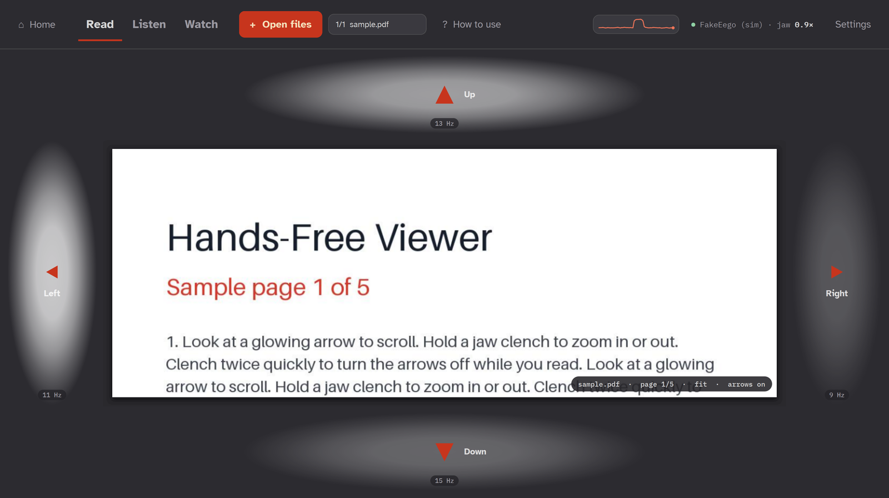
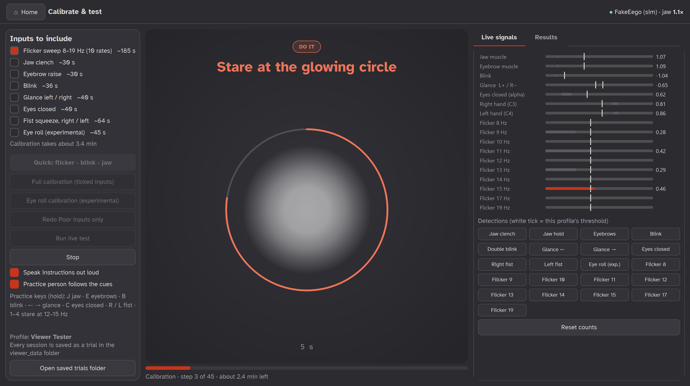

# Hands-Free Viewer

Read a PDF, listen to audio and watch video **without using your hands**.
Look at a glowing arrow to move; clench your jaw to act. Both signals come from an
EEG headset streaming over [LSL](https://labstreaminglayer.org/) (Lab Streaming Layer).



Built for people whose hands don't work but whose eyes and jaw still do, such as people with a
high spinal cord injury or ALS, and for everyday hands-busy moments.

**Team 7** at the Neurotech @ NC State BCI Hackathon (Nov 2026), ANT Neuro track
(*movement-based neurotech applications* on ANT Neuro's 24-channel eego system):
Sola Corrado · Bhoomi Mehta · Takoda Moore · Mahek Shah · Fisher White

**Presentation:** [Google Slides](https://docs.google.com/presentation/d/1OP6dhK9ur_DtLsBWIiw2houKhYR-aIac/edit?usp=sharing)
(includes the demo video) · [PowerPoint copy](slides/HandsFreeViewer_Team7.pptx)

**Highlights on real EEG** (details below)
- **96%** flicker accuracy at 11–15 Hz, averaged over two wearers
- **12/12** correct arrows and **0** wrong ones, and **6/6** jaw clenches, replaying real EEG through the app
- The same results the next day, on a different laptop
- **40 minutes** of anonymized EEG published in [`recordings/`](recordings/)

## How it works

```
ANT eego cap ──LSL──▶ desktop_app.py ──▶ look detector  (O1, O2, Pz, P3, P4)  ──┐
 24 ch, 500 Hz                       └─▶ jaw detector   (T7, T8, T9, T10)     ──┴─▶ scroll · zoom · play/pause · skip
```

- **Look (SSVEP):** each arrow pulses at its own rate (9, 11, 13 or 15 times a second).
  Staring at one makes the visual cortex echo that rate. Every 0.25 s the app compares the
  last 2 s of the back-of-head channels with sine waves at each arrow's rate (canonical
  correlation analysis, CCA). The same winner 3 times in a row counts as a press.
- **Jaw clench:** clenching fires the chewing muscles next to the temporal electrodes,
  causing a burst of 30–100 Hz activity many times above the wearer's own resting level.
  The detector reports a quick clench, a double or triple clench, or a clench held for 1 second.
- The arrows are **soft glows** with a strength setting, easier on the eyes than hard
  flashing boxes. Lower strength is gentler but gives a weaker brain signal.
- Channel names are matched flexibly, so other caps work too (e.g. Oz/POz for flicker,
  M1/M2 for the jaw, where a cap has them).

## Results on real EEG

Four sessions from two wearers over two days are in [`recordings/`](recordings/) (raw EEG, cues,
detections and scores, anonymized as wearer1 and wearer2), with full per-session tables.

| Signal | Result | Used in the viewer |
|---|---|---|
| **Flicker (SSVEP)** | 11–15 Hz: 88–100% for both wearers (96% average). Replaying wearer1's EEG through the app: **12/12** correct arrows (8 on the PDF, 4 on video), **0 wrong**, ~1–1.5 s per look | ✅ arrows |
| **Jaw clench** | 92–100% in every calibration; **6/6** in replay, 0.4–1.4 s after the cue | ✅ actions |
| **Repeatability** | wearer1, 3 sessions over 2 days on 2 laptops: jaw and all four viewer rates 84–100% every time | |
| **Eyes closed** | 100% for both wearers | ✅ "hold" in blink / eye-roll mode |
| **Blink, glance** | wearer2: blink 100%, glance left / right 94% / 81% | ✅ blink mode |
| **Eye roll** (experimental) | 100% in one short wearer1 session | ✅ eye-roll mode |
| Flicker near 10 Hz | 9–10 Hz can clash with the brain's own ~10 Hz alpha rhythm (wearer2: 66–77%), so each profile can choose its rates | ⚠ |
| Fist squeeze, eyebrows | not reliable (25–81%) | ✗ |

Replaying a real recording over LSL into the app: staring at 11 Hz scrolled left, 13 Hz scrolled
up, rates not on screen (10, 17, 19 Hz) fired nothing, and every clench toggled video play/pause.

People blink about 12–13 times a minute and double-blink naturally 2–3 times a minute, so blink
mode is a backup to the jaw: a natural double blink can occasionally trigger it.

## Controls

The flicker rates are the best well-spaced rates from the real sessions; each profile can change them.

| Tab | Look at an arrow | Jaw clench | Keyboard backup |
|-----|------------------|------------|-----------------|
| 📄 **Read** (PDF) | ▲ 13 Hz, ▶ 9 Hz, ▼ 15 Hz, ◀ 11 Hz: scroll; past the edge turns the page | **twice:** arrows off / on (read without flicker) · **hold ~1 s:** zoom in / out | arrow keys · `J` |
| 🎵 **Listen** (audio) | none | **once:** play / pause · **twice:** back 15 s · **3 times:** forward 15 s (hold the last clench to keep skipping) | `J` |
| 🎬 **Watch** (video) | ⏪ 9 Hz back 15 s · ⏩ 13 Hz forward 15 s | same as Listen | ← → · `J` |

- **Other inputs:** under *Settings → Action input*, the jaw can be swapped for a deliberate
  **double blink** or (experimental) **one full eye roll**; closing your eyes for ~1 s is then
  the "hold" (zoom, or back 15 s).
- **Your own files:** *Open files* (or drag files or a whole folder onto the window) takes as many
  PDFs, audio files (mp3, wav, m4a…) and videos (mp4, mov…) as you like. Each tab keeps its own
  list, remembered per profile, and audio and video move on to the next file by themselves.
- **How to use** shows big, plain instructions for the current tab and input.
- The viewer only switches on the inputs it uses, so other detectors can't steal events (on the
  real recordings, clenching also tensed the forehead and could be read as an eyebrow raise).
- `J` behaves like your jaw (tap, double tap, hold); `1` / `2` / `3` switch between **Read**,
  **Listen** and **Watch**. The keyboard always works, so a demo still runs if the EEG is noisy.

## Setup

Needs [uv](https://docs.astral.sh/uv/) (it installs Python 3.13 and all libraries for you), on
Windows, macOS or Linux. Install while you have internet: EEG lab networks often have none.

```bash
git clone https://github.com/solacorrado/eeg-interpreter.git
cd eeg-interpreter
uv sync                                   # install libraries
uv run python bci_demo/make_media.py      # make the sample PDF, audio and video
```

## Run

### Desktop app (the full version)

```bash
uv run python bci_demo/desktop_app.py            # real headset: connect on the start screen
uv run python bci_demo/desktop_app.py --fake     # start with the practice (fake) headset
```

**Start screen**
1. **Profile:** pick who is wearing the headset, or make a new profile. Each wearer gets
   their own calibrated settings.
2. **Headset:** *Real headset* (press **Search** to list LSL streams, or use "first EEG
   stream"), or *Practice headset* (fake signals). Press **Connect**. The green dot shows
   the stream, channel count and rate.
3. Choose **Calibrate & test** or **Use the viewer**.

**Calibrate & test**
- **Quick calibration** (about 4.5 min): the viewer's four flicker rates, then blink, then jaw.
- **Full calibration:** tick any inputs: a flicker sweep of 10 rates (8–19 Hz), jaw clench,
  eyebrow raise, blink, glance left/right, eyes closed, fist squeeze right/left, and an
  experimental eye roll (which also has its own short calibration).
- The wearer follows the cues; each cue is **spoken out loud**, and the step only starts once
  it has been said, so the wearer doesn't need to read the screen.
  For every input the app finds the threshold that best separates "doing it" from
  "resting" and grades it **Good** (≥90%), **OK** (≥75%) or **Poor**. Good and OK
  inputs update the profile; Poor ones keep their old settings.
- **Randomized:** each calibration shuffles the order of the input blocks and of the trials
  inside each block, and varies every rest by -20% to +30%, so the wearer can't anticipate
  cues and slow drift can't line up with one class. The shuffle seed is saved with the trial.
- **Redo Poor inputs only:** recalibrates just the inputs whose last calibration had a Poor result.
- **Run live test:** random cues; the live detectors (using the profile) must fire the
  right event in time. Reports hit rate, reaction time and false alarms per minute.
- **Live signals:** a bar for every signal with the profile's threshold marked, and a
  light for every detection. Good for checking the headset before you start.
- With the practice headset, "Practice person follows the cues" makes the fake signals
  act out each cue, so the whole flow can be tried without hardware. Practice keys:
  J jaw, E eyebrows, B blink, ← → glance, C eyes closed, R / L fist, 1–4 stare at 12–15 Hz.



**Viewer:** the PDF / audio / video controls above, using the profile's settings.

**Plugging in the real headset.** The app reads whatever ANT's eego software streams over
LSL on their network. It copes with streams whose type isn't exactly "EEG", any sample
rate, volts or microvolts (every signal is measured against the wearer's own resting
level), labels like `Fp1-CPz` or `EEG O1`, and extra trigger/counter channels. If a
channel it needs can't be found, the start screen says which one. Needs: LSL streaming
turned on in eego, your laptop on ANT's network, and Python allowed through the Windows firewall.

**If something goes wrong mid-session:** the status line turns red ("NO DATA for N s") if
the headset stops sending (LSL reconnects by itself). **Stop** offers to save what was
recorded as a *partial* trial (scored, but it doesn't change the profile's settings), and
closing the window mid-session saves it automatically.

### Self-test (no headset needed)

```bash
uv run python bci_demo/selftest.py
```

About 2 minutes, no headset. It checks the libraries, the sample files and the data folder,
then runs a short calibration and live test on the practice headset. Ends with PASS or FAIL.

### After a session: re-analyse the recordings

Every trial keeps the raw EEG, so detection can be improved without the headset. Change the
code, then re-score real recordings with it:

```bash
uv run python bci_demo/reanalyze.py                       # list saved trials
uv run python bci_demo/reanalyze.py latest                # re-score the newest one
uv run python bci_demo/reanalyze.py all --profile wearer1   # every trial for one wearer
uv run python bci_demo/reanalyze.py latest --csv          # also export eeg.csv (time + channels)
```

It prints the old score next to the new one for every input. The live app and this tool
share the same processing code and cut the data into identical 40 ms steps, so a re-run of
unchanged code reproduces the original scores exactly.

### What gets saved, and where

Everything goes to **Documents/HandsFreeViewer** (outside the code, so updates and
re-clones never touch it):

```
profiles/<name>.json        settings + latest result per input + full history of every session
profiles/<name>.json.bak    the previous version of that file
trials/<name>/<date>_calibration|test[_partial]/
trials/index.csv            one row per input per session: the "what works" log
```

| File in each trial folder | Format | Contents | Open with |
|---|---|---|---|
| `eeg.npz` | NumPy compressed archive | raw EEG (samples × channels), timestamps, channel names, sample rate | Python `numpy.load`, `reanalyze.py` |
| `eeg.csv` (optional) | CSV | time + one column per channel (`reanalyze.py latest --csv`) | Excel, MATLAB, anything |
| `cues.csv` | CSV | what the wearer was asked to do, and when | Excel |
| `events.csv` | CSV | what the app detected, and when | Excel |
| `features.csv` | CSV | processed signals, 25 rows per second | Excel |
| `results.json` | JSON | scores, verdicts, settings used, app version, shuffle seed | text editor |

ANT's eego software saves its own copy of a session as `.cnt` / `.edf` (standard EEG formats).

Profiles record the app version that made each result and carry a schema version, so
newer app versions can still read them.

### Web app (simple version: flicker + jaw only)

```bash
uv run python bci_demo/server.py --fake     # then open http://localhost:8780
uv run python bci_demo/server.py
```

Options: `--pdf FILE`, `--ssvep-threshold 0.42`, `--clench-factor 5`, `--port 8780`.

## Files

```
bci_demo/
  desktop_app.py  the desktop app: start screen, calibrate & test, viewer (PySide6 / Qt)
  live_engine.py  reads the LSL stream; the shared Pipeline (features -> events) used live and offline
  features.py     raw EEG -> jaw / brow / blink / glance / alpha / hand-rhythm features, SSVEP scores
  gestures.py     features -> events, using a profile's thresholds
  calibration.py  calibration and live-test steps (randomized) and scoring
  storage.py      profiles and trial recordings on disk
  reanalyze.py    re-score saved trials with the current code; export EEG to CSV
  selftest.py     2-minute readiness check on the practice headset
  version.py      app version, stored with every result
  fake_eeg.py     practice headset: a fake 24-channel eego stream that can do every input
  make_media.py   generates the sample PDF, audio and video
  icon.ico        app icon
  server.py, engine.py, detect.py, static/index.html
                  the simpler web version (flicker + jaw)
```

## Status

- **Real headset:** connects to ANT's eego stream over LSL, and reconnects by itself when eego
  restarts its stream (which plain LSL can't do for that stream).
- **Tested** on two able-bodied wearers over two days: accuracy measured in calibration and by
  replaying real EEG through the app (see *Results on real EEG*).
- **Next:** testing with the people it's built for (spinal cord injury, ALS); automatic
  calibration from a short recording; filter-bank CCA for a stronger flicker score; fewer
  electrodes toward a lighter wearable.
- Everything also runs on the practice headset (calibration, live test, viewer), so it can be
  tried without any hardware: `uv run python bci_demo/desktop_app.py --fake`.

## Safety

The arrows flicker at 8–19 Hz. Flicker in this range can trigger seizures in people with
photosensitive epilepsy. Don't use it if that applies to you or anyone watching.
